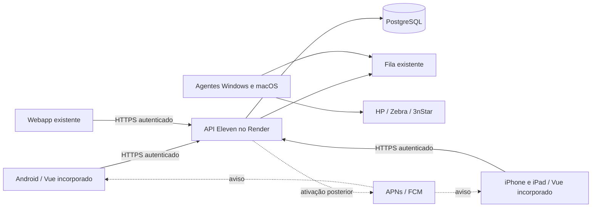

# Eleven para Android, iPhone e iPad

Piloto iniciado em 12/11/2026. Este documento descreve o que está implementado e
o que ainda depende de contas, assinatura e homologação física. **Build aprovado
não significa aplicativo publicado ou impressão física conferida.**

## Arquitetura e escopo

O aplicativo incorpora o frontend Vue existente com Capacitor 8. A API FastAPI e
o PostgreSQL permanecem no Render. Não há cópia independente do banco nem outro
servidor pago para o app. Web e aplicativos usam as mesmas permissões, sessões,
validações e filas. O perfil de consulta permanece sem autorização de alteração.



| Função | Implementação do piloto |
| --- | --- |
| Interface | Telas incorporadas ao binário; identidade visual Eleven; navegação atual |
| Login | Keychain no iOS; AES-GCM com Android Keystore no Android; token fora do armazenamento web |
| Sem “Lembrar-me” | Credencial em memória do processo; sobrevive ao reload do login, mas exige login após encerrar o processo |
| Retomada | Revalida sessão; conserva expiração diária às 21h de Brasília e revogação no servidor |
| QR/código de barras | Scanner nativo compartilhado, câmera traseira, entrada manual e tratamento de cancelamento/permissão |
| Fotos | Upload existente e captura pelo aparelho; sem permissão ampla de armazenamento |
| PDF | Compartilhamento de arquivo local em vendas/PDV, pedidos/condicionais, conferência, endereços/SuperFrete e histórico do cliente |
| Impressão da loja | Mesmas filas e agentes; nenhuma porta de impressora exposta |
| Notificações nativas | Código e migração preparados; flags desligadas até configurar credenciais e testar |
| Consulta sem internet | Apenas recursos já existentes de índice do catálogo; estoque confirmado e operações continuam exigindo rede |

Exportações CSV/ZIP ainda usam os caminhos do navegador e não fazem parte da
homologação nativa deste piloto. O scanner do plugin é encerrado pelo usuário na
tela nativa; resultados tardios após sair da tela são descartados. Botão Voltar do
Android, teclado, áreas seguras e formulários precisam de teste em aparelho real.
O app não fica executando continuamente em segundo plano. O projeto de servidor
local da Rede Eleven e sincronização offline permanece separado.

## Segurança e dados

- `com.elevenparispy.erp` é o identificador definitivo do APK privado. Confirmar
  esse mesmo App ID na conta Apple antes de assinar o aplicativo iOS.
- O APK de teste usa `com.elevenparispy.erp.pilot` e o nome **Eleven Piloto**.
  Instala ao lado do app final; não é atualizado por ele. O APK privado definitivo
  exige um novo login, mantendo os dados operacionais no mesmo ERP.
- Nenhum `server.url` remoto nem navegação externa recebe a ponte nativa.
  Assets são incorporados, API é HTTPS e a CSP limita as conexões à API configurada.
- CORS aceita as origens locais do Capacitor, sem dispensar autenticação.
- Logout limpa sessão e PDFs privados; guardas de instalação impedem restaurar
  tokens antigos. PDFs são limitados a 20 MB e removidos no início/logout e, após
  24 horas, na próxima operação de compartilhamento. Não há limpeza em background.
- Android desabilita backup e limita FileProvider ao cache de PDFs e à pasta
  privada `Pictures/` usada pela captura de fotos do Capacitor.
- `PrivacyInfo.xcprivacy` declara finalidade operacional e APIs de timestamp.
  A ficha de privacidade das lojas deve ser conferida com os dados reais do ERP:
  identidade/contato, endereços, fotos, compras/pagamentos, auditoria e dispositivos.
  Isso não substitui a política de privacidade da empresa nem sua revisão final.
- Segredos de assinatura, APNs e Firebase ficam nos ambientes protegidos, nunca
  em `VITE_*`, no repositório, no APK ou em mensagens. `google-services.json` é
  configuração do aplicativo; sua chave de serviço administrativa é outro arquivo,
  exclusivo do backend.

## Compilar e validar

Requisitos locais: Node da `frontend/.nvmrc` (22), Java 21/Android Studio com SDK 36
para Android, e macOS com Xcode 26 ou superior para iOS. O mínimo do app é Android
8/API 26 e iOS/iPadOS 16.4; o scanner exige Android 26. Testar principalmente os
Samsung e iPhones/iPads usados pela equipe. Não aceitar licenças nem instalar IDEs
em nome da empresa sem o titular concluir os termos necessários.

```sh
npm --prefix frontend ci --include=dev
npm --prefix frontend test
npm --prefix frontend run type-check
npm --prefix frontend run build
npm --prefix frontend run mobile:sync
npm --prefix frontend run mobile:check
npm --prefix frontend run mobile:android
# ou, em Mac com Xcode:
npm --prefix frontend run mobile:ios
```

`mobile:sync` gera `dist-mobile` e sincroniza os dois projetos. Copiar só arquivos
Vue sem gerar um novo binário não atualiza o app instalado. O webapp continua
publicado normalmente. `MOBILE_API_BASE_URL` aceita somente uma origem HTTPS; o
padrão é a API atual do Render. A CI registra commit/origem/versão em
`mobile-build.json` e gera SHA-256 dos artefatos. Nunca usar dados operacionais em
testes automatizados. `VITE_NATIVE_PUSH_ENABLED` permanece ausente/false no piloto.

A workflow **Build Eleven Mobile** compila Android (testes unitários, lint, APK de
debug e AAB release sem assinatura) e iOS para simulador sem assinatura. Os
artefatos ficam no GitHub Actions por 30 dias. O APK de debug serve para teste
acompanhado; a chave de debug não é identidade permanente de distribuição.
O AAB sem assinatura não é publicável e o ZIP de simulador não instala no iPhone.
Não chamar nenhum deles de versão de produção das lojas. A CI produz o APK release
sem assinatura para a distribuição privada; a assinatura definitiva é realizada
**localmente**, sem enviar a chave ou a senha ao GitHub. A chave PKCS12 fica no
diretório `secrets/` ignorado pelo Git, com acesso restrito; fazer backup privado
sob controle de Lucas. A configuração FCM só é incluída quando fornecida; isso não
ativa por si só o push no backend.

Para assinatura local sem instalar Android SDK, `SignAndroidRelease.java` usa a
biblioteca oficial `com.android.tools.build:apksig:8.13.1` (Apache 2.0) e Java 21.
Baixar JDK Temurin pelo Adoptium e o JAR pelo Google Maven; conferir os checksums
oficiais antes de executar. Não é necessário aceitar licenças do SDK nesse caminho.
O helper recusa APK debuggable, assina em v2/v3, preserva alinhamento do APK da CI,
verifica assinatura e identidade e só então grava o arquivo final. Não publica nem
faz requisições de rede. Os argumentos são caminhos, nunca a senha em texto:

```sh
# ELEVEN_JAVA_BIN: diretório bin do JDK local; ELEVEN_APKSIG_JAR: JAR verificado.
# ELEVEN_SIGN_CLASSES: diretório temporário das classes compiladas.
"$ELEVEN_JAVA_BIN/javac" -cp "$ELEVEN_APKSIG_JAR" -d "$ELEVEN_SIGN_CLASSES" \
  frontend/scripts/SignAndroidRelease.java
"$ELEVEN_JAVA_BIN/java" -cp "$ELEVEN_SIGN_CLASSES:$ELEVEN_APKSIG_JAR" \
  SignAndroidRelease sign /caminho/app-release-unsigned.apk /caminho/Eleven-Android.apk \
  /caminho/privado/eleven-android.p12 /caminho/privado/store-password.txt
```

A saída mostra apenas hash/tamanho do APK e fingerprint do certificado público.
Conferir também package ID, versão e `versionCode` da build antes de publicar;
validação de assinatura não substitui essa conferência nem o teste em aparelho.


## Distribuição privada escolhida em 13/11/2026

O grupo inicial é de aproximadamente sete iPhones e três Androids. A distribuição
será pelo endereço **https://elevenparispy.com/download**, também acessível no
rodapé do login web. Não há publicação pública nas buscas das lojas nesta etapa.
A página tem recursos próprios, sem carregar o ERP ou exigir uma sessão, mas o
aplicativo continua exigindo login e as mesmas permissões do servidor.

- **Android:** APK privado definitivo **1.0.1**, com versão, tamanho e SHA-256,
  assinado com chave de release estável. A identidade `com.elevenparispy.erp` é
  distinta do `.pilot`: instala separado do piloto e pede um novo login. Os dados
  continuam no ERP, sem migração ou cópia. Atualizações dessa versão devem preservar
  a chave e aumentar `versionCode`. Não orientar a desativar Play Protect.
  Distribuição fora da Google Play continua sujeita às verificações vigentes do
  Android conforme região/canal.
- **iPhone/iPad:** instalação Ad Hoc, apenas nos UDIDs cadastrados no perfil.
  O estado inicial da página é **aguardando assinatura Apple e cadastro dos aparelhos**.
  O ZIP do simulador não é oferecido como instalador. O botão de instalação só
  poderá ser ativado quando houver um IPA assinado, verificado e hospedado.
- **Atualizações:** publicar uma versão web não atualiza o frontend incorporado aos
  aplicativos. Gerar novo binário e orientar sua instalação. A instalação privada
  não oferece atualização silenciosa garantida. Conservar o webapp como alternativa.
- **Limite Apple:** até 100 dispositivos por família (por exemplo, iPhones) por ano
  de associação. São aparelhos registrados, não downloads; desativar um aparelho
  não libera imediatamente sua vaga.

Referências: [APK pelo próprio site](https://developer.android.com/distribute/marketing-tools/alternative-distribution),
[verificação Android](https://developer.android.com/developer-verification/guides),
[dispositivos Apple](https://developer.apple.com/help/account/devices/devices-overview/),
[distribuição Ad Hoc, seção 7.3](https://developer.apple.com/support/terms/apple-developer-program-license-agreement/).

### Assinatura Apple: Lucas conclui pessoalmente

Iniciar em **https://developer.apple.com/programs/enroll/**. O Apple Developer
Program comum custa US$ 99 por ano, sujeito à moeda/região. O cadastro pode ser
individual ou de organização conforme a titularidade escolhida; não é necessário
Apple Developer Enterprise para esse grupo. Organização exige identidade legal,
D-U-N-S e autoridade para representá-la. Lucas conclui identidade, contratos e
pagamento; não compartilhar senha, 2FA ou cartão em mensagens.

Não é necessário pagar Google Play Console para listar esse APK no próprio site.
Uma eventual distribuição pela Play Store será uma etapa separada. Verificação do
desenvolvedor Android fora da loja e a assinatura de release também são assuntos
distintos. Firebase/FCM e APNs permanecem sem ativação até sua configuração e teste.
A verificação da conta Apple pode levar dias; não prometer instalação imediata.

### Obter os UDIDs sem instalar perfis de terceiros

**No Mac da loja, pelo Finder:**

1. Conectar o iPhone por cabo, desbloquear e confirmar **Confiar** no Mac e no iPhone.
2. Abrir Finder e selecionar o aparelho em **Locais**.
3. Clicar nas informações do modelo logo abaixo do nome do aparelho até aparecer
   **UDID**. O Finder alterna entre os identificadores.
4. Clicar com o botão direito/Control-clique no UDID e escolher **Copiar UDID**.
5. Guardar numa lista privada com nome do responsável e modelo. Compartilhar somente
   com Lucas/responsável pelo cadastro da Apple, não em issue, commit ou página pública.

O UDID não é o IMEI nem o número de série. A página `/download` não coleta nem
armazena esses identificadores. Não instalar perfis de sites desconhecidos para
extraí-los. No Xcode, também é possível copiar o identificador no Device Hub ou
em **Window → Devices and Simulators**, conforme sua versão. Para este piloto,
preferir o Finder disponível no Mac da loja; não presumir que Apple Devices no
Windows exponha UDID apenas porque exibe série/IMEI.

[Instruções oficiais do Finder/Xcode](https://developer.apple.com/documentation/xcode/locating-device-identifiers)
· [Guia Apple com Finder](https://help.apple.com/xcode/mac/current/en.lproj/dev93ef696c6.html)
· [Registrar aparelho](https://developer.apple.com/help/account/devices/register-a-single-device/).

### Preparar o IPA e o manifesto após a conta ser aprovada

1. Cadastrar os aparelhos na conta Apple, confirmar o App ID e a equipe de assinatura.
2. No Xcode, gerar archive para dispositivo físico e exportar por distribuição
   **Ad Hoc / Release Testing**, conforme a versão do Xcode, incluindo esses aparelhos.
   Não usar Development, Enterprise, App Store ou build de simulador neste fluxo.
3. No Mac, validar o IPA exportado e gerar os arquivos de instalação:

```sh
python3 frontend/scripts/package-adhoc.py /caminho/privado/Eleven.ipa \
  --ipa-url https://elevenparispy.com/download/ios/Eleven.ipa \
  --manifest-url https://elevenparispy.com/download/ios/manifest.plist \
  --output /caminho/privado/instalacao-eleven
```

Essas URLs são exemplos para preparar o pacote, **não arquivos já publicados**.
O utilitário não assina nem envia o IPA, não cadastra dispositivos e não muda a
página de download. Ele requer macOS e executa `codesign` e `security cms`; verifica
assinatura Apple, certificado autorizado pelo perfil, identidade/equipe, build de
dispositivo físico, lista de aparelhos não vazia, perfil Ad Hoc sem debug/Enterprise
e vencimento. Perfil vencido ou pacote sem assinatura interrompem a geração.

A saída contém apenas `manifest.plist` e `ios-release.json`. O manifesto usa o
`CFBundleVersion` real do aplicativo; o JSON inclui versão visível, build, bundle ID,
validade, URLs, tamanho e SHA-256, **sem a lista de UDIDs, perfil ou certificados**.
A validação não comprova instalação física nem compara bytes hospedados com o
arquivo local; ambas as verificações são necessárias antes da ativação.

**Privacidade da hospedagem:** o próprio IPA Ad Hoc contém `embedded.mobileprovision`
com os UDIDs autorizados. Não enviar o IPA a um release público do GitHub sem tratar
essa exposição. Definir acesso controlado compatível com a instalação OTA e só então
publicar o manifesto e o campo `ios` de `releases.json`. O script aceita URLs HTTPS
estáveis sem credenciais/query/fragmento, para não gravar tokens temporários em
metadados publicados. Uma hospedagem com URLs assinadas temporárias exige fluxo
servidor específico e não está implementada nesta etapa.

4. Conferir download, hash e instalação física em um iPhone cadastrado. Conforme a
   documentação Apple, habilitar **Modo de Desenvolvedor** para a instalação em
   aparelhos registrados. Preservar os controles de segurança do aparelho.
5. Depois da conferência, disponibilizar `itms-services` apontando ao manifesto HTTPS;
   ativar a opção iPhone na página apenas com metadata válida e perfil ainda vigente.
6. Registrar a data real de validade. Renovar perfil/assinatura e redistribuir antes
   de expirar; o aplicativo pode deixar de abrir com autorização vencida. Incluir
   um iPhone novo exige atualizar o perfil e exportar novo pacote.

[Instalação Apple em dispositivos registrados](https://developer.apple.com/documentation/xcode/distributing-your-app-to-registered-devices)
· [Perfis Ad Hoc](https://developer.apple.com/help/account/provisioning-profiles/create-an-ad-hoc-provisioning-profile/).

Testes isolados do empacotador (sem conta Apple, sem perfil real e sem publicação):

```sh
python3 -m unittest discover -s frontend/scripts -p 'test_package_adhoc.py' -v
```

### Notificações e homologação

Configurar o pacote Android correto no Firebase (o `.pilot` é outro app), APNs
ambiente/topic e capability **Push Notifications** no Xcode. Credenciais do servidor
ficam no Render. Só depois ligar as flags e testar entrega, toque, logout, troca de
usuário, permissão negada e expiração às 21h. Detalhes em
[Notificações](NOTIFICACOES.md#aplicativos-androidios--piloto-nativo).

Notificações não podem ser forçadas contra a permissão do sistema operacional.
O primeiro piloto nativo usa aviso genérico ELEVEN e consulta dados autorizados
após abrir: uma notificação já entregue ao provedor pode chegar após o logout.
Conteúdo comercial completo na tela bloqueada exige outra decisão de privacidade
e implementação específica, não está habilitado por este piloto.

## Homologação antes de ampliar o uso

- Login com/sem Lembrar-me; encerrar/reabrir app; logout/troca de usuário; senha
  obrigatória; revogação e expiração 21h. Confirmar perfil de consulta sem escrita.
- Abrir estoque/grades/reposição, fotos, filtros e PDV em Samsung, iPhone e iPad.
- Ler QR de etiqueta real, código de barras, negar câmera, cancelar, digitar código,
  sair da tela enquanto scanner está aberto; confirmar que não duplica produtos.
- Compartilhar PDF com arquivo somente; cancelar; salvar; trocar usuário durante
  preparo; conferir que nenhum PDF anterior é reaproveitado para outra pessoa.
- Impressão: teste físico autorizado com um ticket e uma etiqueta, na fila correta,
  sem simular venda/pagamento para validar interface. Conferir idempotência.
- Rede lenta/ausente: indicar falha, não inventar estoque atualizado nem registrar
  venda como concluída sem confirmação. Voltar à rede e revalidar sessão/dados.
- Push após ativação: aparelho em primeiro/segundo plano, app encerrado, permissão
  recusada, toque em aviso e sessão expirada. Confirmar autorização do conteúdo.
- Registrar modelo, SO, versão/build, resultado e erro sem credenciais. A evidência
  automatizada da CI complementa, mas não substitui, essas conferências físicas.

## Manutenção

App e API passam a ter ciclos diferentes. Evoluções do backend devem preservar os
clientes instalados ou prever versão mínima/atualização antes de remover contratos.
As atualizações privadas também devem conservar o controle de versões e a assinatura;
não ativar atualização remota de JavaScript que altere a fronteira de confiança nativa.
Manter `main` protegida, PR `codex/`, validações habituais e builds nativos aprovados.
O Android privado já possui caminho de assinatura de release. A assinatura iOS
e sua ativação dependem da aprovação da conta Apple, dos UDIDs e da validação do
IPA em aparelho físico. Não publicar como disponível antes dessas etapas.
