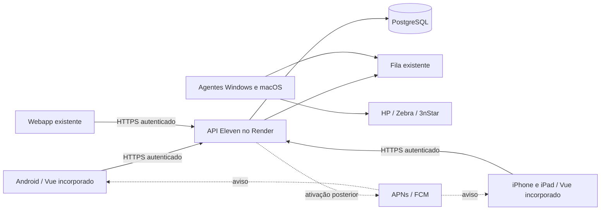

# Eleven para Android, iPhone e iPad

Piloto iniciado em 12/11/2026. Este documento descreve o que está implementado e
o que ainda depende de contas, assinatura e homologação física. **Build aprovado
não significa aplicativo publicado ou impressão física conferida.**

## Arquitetura e escopo

O aplicativo incorpora o frontend Vue existente com Capacitor 8. A API FastAPI e
o PostgreSQL permanecem no Render. Não há cópia independente do banco nem outro
servidor pago para o app. Web e aplicativos usam as mesmas permissões, sessões,
validações e filas. O perfil de consulta permanece sem autorização de alteração.



| Função | Implementação do piloto |
| --- | --- |
| Interface | Telas incorporadas ao binário; identidade visual Eleven; navegação atual |
| Login | Keychain no iOS; AES-GCM com Android Keystore no Android; token fora do armazenamento web |
| Sem “Lembrar-me” | Credencial em memória do processo; sobrevive ao reload do login, mas exige login após encerrar o processo |
| Retomada | Revalida sessão; conserva expiração diária às 21h de Brasília e revogação no servidor |
| QR/código de barras | Scanner nativo compartilhado, câmera traseira, entrada manual e tratamento de cancelamento/permissão |
| Fotos | Upload existente e captura pelo aparelho; sem permissão ampla de armazenamento |
| PDF | Compartilhamento de arquivo local em vendas/PDV, pedidos/condicionais, conferência, endereços/SuperFrete e histórico do cliente |
| Impressão da loja | Mesmas filas e agentes; nenhuma porta de impressora exposta |
| Notificações nativas | Código e migração preparados; flags desligadas até configurar credenciais e testar |
| Consulta sem internet | Apenas recursos já existentes de índice do catálogo; estoque confirmado e operações continuam exigindo rede |

Exportações CSV/ZIP ainda usam os caminhos do navegador e não fazem parte da
homologação nativa deste piloto. O scanner do plugin é encerrado pelo usuário na
tela nativa; resultados tardios após sair da tela são descartados. Botão Voltar do
Android, teclado, áreas seguras e formulários precisam de teste em aparelho real.
O app não fica executando continuamente em segundo plano. O projeto de servidor
local da Rede Eleven e sincronização offline permanece separado.

## Segurança e dados

- `com.elevenparispy.erp` é o identificador definitivo proposto; confirmar sua
  disponibilidade nas contas da empresa antes da primeira publicação.
- O APK de teste usa `com.elevenparispy.erp.pilot` e o nome **Eleven Piloto**.
  Instala ao lado do app final; não é atualizado pela futura versão da loja.
- Nenhum `server.url` remoto nem navegação externa recebe a ponte nativa.
  Assets são incorporados, API é HTTPS e a CSP limita as conexões à API configurada.
- CORS aceita as origens locais do Capacitor, sem dispensar autenticação.
- Logout limpa sessão e PDFs privados; guardas de instalação impedem restaurar
  tokens antigos. PDFs são limitados a 20 MB e removidos no início/logout e, após
  24 horas, na próxima operação de compartilhamento. Não há limpeza em background.
- Android desabilita backup e limita FileProvider ao cache de PDFs e à pasta
  privada `Pictures/` usada pela captura de fotos do Capacitor.
- `PrivacyInfo.xcprivacy` declara finalidade operacional e APIs de timestamp.
  A ficha de privacidade das lojas deve ser conferida com os dados reais do ERP:
  identidade/contato, endereços, fotos, compras/pagamentos, auditoria e dispositivos.
  Isso não substitui a política de privacidade da empresa nem sua revisão final.
- Segredos de assinatura, APNs e Firebase ficam nos ambientes protegidos, nunca
  em `VITE_*`, no repositório, no APK ou em mensagens. `google-services.json` é
  configuração do aplicativo; sua chave de serviço administrativa é outro arquivo,
  exclusivo do backend.

## Compilar e validar

Requisitos locais: Node da `frontend/.nvmrc` (22), Java 21/Android Studio com SDK 36
para Android, e macOS com Xcode 26 ou superior para iOS. O mínimo do app é Android
8/API 26 e iOS/iPadOS 16.4; o scanner exige Android 26. Testar principalmente os
Samsung e iPhones/iPads usados pela equipe. Não aceitar licenças nem instalar IDEs
em nome da empresa sem o titular concluir os termos necessários.

```sh
npm --prefix frontend ci --include=dev
npm --prefix frontend test
npm --prefix frontend run type-check
npm --prefix frontend run build
npm --prefix frontend run mobile:sync
npm --prefix frontend run mobile:check
npm --prefix frontend run mobile:android
# ou, em Mac com Xcode:
npm --prefix frontend run mobile:ios
```

`mobile:sync` gera `dist-mobile` e sincroniza os dois projetos. Copiar só arquivos
Vue sem gerar um novo binário não atualiza o app instalado. O webapp continua
publicado normalmente. `MOBILE_API_BASE_URL` aceita somente uma origem HTTPS; o
padrão é a API atual do Render. A CI registra commit/origem/versão em
`mobile-build.json` e gera SHA-256 dos artefatos. Nunca usar dados operacionais em
testes automatizados. `VITE_NATIVE_PUSH_ENABLED` permanece ausente/false no piloto.

A workflow **Build Eleven Mobile** compila Android (testes unitários, lint, APK de
debug e AAB release sem assinatura) e iOS para simulador sem assinatura. Os
artefatos ficam no GitHub Actions por 30 dias. O APK de debug serve para teste
acompanhado; a chave de debug não é identidade permanente de distribuição.
O AAB sem assinatura não é publicável e o ZIP de simulador não instala no iPhone.
Não chamar nenhum deles de versão de produção das lojas.

## Contas e pagamentos: Lucas conclui pessoalmente

| Etapa | Custo-base publicado | Ação do titular |
| --- | --- | --- |
| [Apple Developer Program](https://developer.apple.com/programs/enroll/) | US$ 99/ano, sujeito à moeda/região | Cadastro, identidade, empresa/D-U-N-S quando exigido, contrato e pagamento |
| [Google Play Console](https://play.google.com/console/signup) | US$ 25, pagamento único, sujeito à região | Cadastro de organização, verificação, contrato e pagamento |
| [Firebase Console](https://console.firebase.google.com/) | FCM sem cobrança pelo envio de notificações | Criar projeto da empresa e vincular Android; não habilitar faturamento/serviços extras sem necessidade |
| Ferramentas locais | Xcode e Android Studio gratuitos | Instalar quando necessário e aceitar seus termos pessoalmente |

Preferir contas pertencentes à empresa, com Lucas como titular e acesso delegado
para distribuição. Não compartilhar senha/2FA nem dados do cartão. A verificação
da empresa pode levar dias; não é possível garantir publicação no dia seguinte.
GitHub Actions pode consumir a franquia de CI, especialmente macOS; consultar o
plano da conta antes de aumentar paralelismo ou automatizar builds frequentes.

Referências: [Apple membership](https://developer.apple.com/programs/enroll/),
[cadastro Google e taxa](https://support.google.com/googleplay/android-developer/answer/6112435),
[Firebase pricing](https://firebase.google.com/pricing).

## Distribuição após o cadastro

1. Confirmar empresa, bundle ID, nome, ícone e responsável por suporte/privacidade.
   Habilitar acesso de publicação com menor privilégio possível.
2. Android: criar chave de upload protegida, backup sob controle da empresa e Play
   App Signing. Configurar assinatura de release por segredo da CI; aumentar
   `versionCode` a cada envio. Enviar primeiro para teste interno, instalar e
   conferir atualização. Requisitos adicionais variam conforme tipo da conta.
3. iOS: configurar Team, App ID, certificado/provisionamento e App Store Connect.
   Criar archive assinado e enviar ao TestFlight. TestFlight é piloto (build expira
   em 90 dias), não distribuição definitiva. Testes externos podem exigir revisão.
4. Configurar push: pacote Android correto no Firebase (o `.pilot` é outro app),
   APNs topic/ambiente e capability **Push Notifications** no Xcode. Credenciais do
   servidor ficam no Render. Só depois ligar as flags e fazer testes consentidos
   de entrega, toque, logout, troca de usuário, permissão negada e expiração 21h.
   Detalhes em [Notificações](NOTIFICACOES.md#aplicativos-androidios--piloto-nativo).
5. Preparar imagens reais, texto da loja, política de privacidade em URL pública,
   ficha de dados coletados, classificação etária, suporte e conta de demonstração
   sem dados reais para revisão. Verificar requisitos vigentes das duas lojas.
6. Após piloto aceito, publicar Android em canal adequado à equipe. Para Apple,
   avaliar app não listado (acesso por link, sujeito à revisão) ou distribuição
   empresarial gerenciada elegível. O login/permissões do ERP continua obrigatório.
7. Só ampliar distribuição após confirmar upgrade sem perda de sessão indevida,
   scanner, PDFs e fila de impressão em aparelhos reais. Conservar webapp como
   alternativa durante o piloto.

Notificações não podem ser forçadas contra a permissão do sistema operacional.
O primeiro piloto nativo usa aviso genérico ELEVEN e consulta dados autorizados
após abrir: uma notificação já entregue ao provedor pode chegar após o logout.
Conteúdo comercial completo na tela bloqueada exige outra decisão de privacidade
e implementação específica, não está habilitado por este piloto.

## Homologação antes de ampliar o uso

- Login com/sem Lembrar-me; encerrar/reabrir app; logout/troca de usuário; senha
  obrigatória; revogação e expiração 21h. Confirmar perfil de consulta sem escrita.
- Abrir estoque/grades/reposição, fotos, filtros e PDV em Samsung, iPhone e iPad.
- Ler QR de etiqueta real, código de barras, negar câmera, cancelar, digitar código,
  sair da tela enquanto scanner está aberto; confirmar que não duplica produtos.
- Compartilhar PDF com arquivo somente; cancelar; salvar; trocar usuário durante
  preparo; conferir que nenhum PDF anterior é reaproveitado para outra pessoa.
- Impressão: teste físico autorizado com um ticket e uma etiqueta, na fila correta,
  sem simular venda/pagamento para validar interface. Conferir idempotência.
- Rede lenta/ausente: indicar falha, não inventar estoque atualizado nem registrar
  venda como concluída sem confirmação. Voltar à rede e revalidar sessão/dados.
- Push após ativação: aparelho em primeiro/segundo plano, app encerrado, permissão
  recusada, toque em aviso e sessão expirada. Confirmar autorização do conteúdo.
- Registrar modelo, SO, versão/build, resultado e erro sem credenciais. A evidência
  automatizada da CI complementa, mas não substitui, essas conferências físicas.

## Manutenção

App e API passam a ter ciclos diferentes. Evoluções do backend devem preservar os
clientes instalados ou prever versão mínima/atualização antes de remover contratos.
Não ativar atualização remota de JavaScript para contornar revisão das lojas.
Manter `main` protegida, PR `codex/`, validações habituais e builds nativos aprovados.
As builds assinadas e sua ativação só serão acrescentadas após existir a conta da
empresa; este piloto não cria nem guarda uma identidade de assinatura definitiva.
