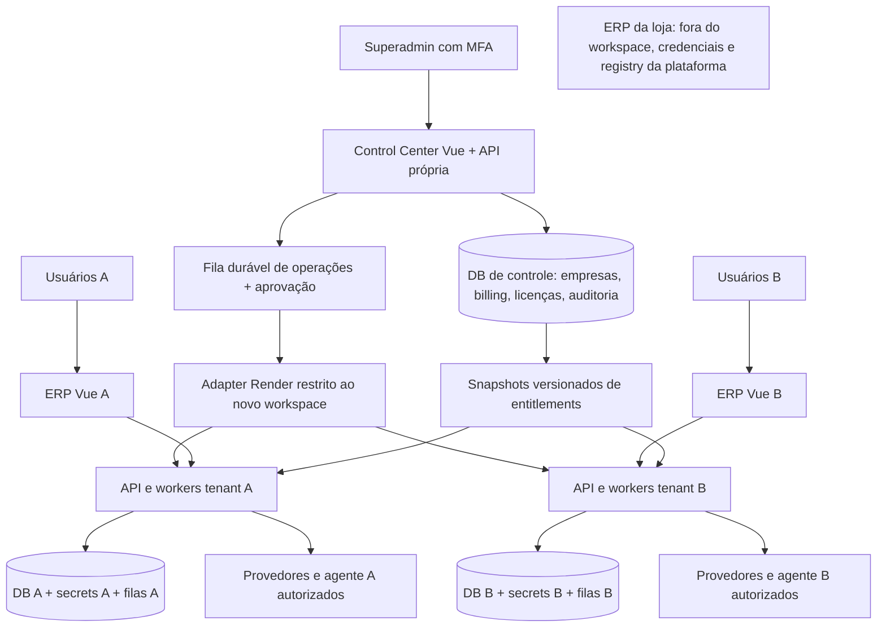

# Arquitetura proposta — decisões da Fase 0

Este documento descreve o alvo da Issue #70. As estruturas abaixo ainda não existem
no ERP original. Sua existência futura depende de implementação, migração e testes
no repositório privado independente.

## ADR-001: piloto com instância e banco por empresa

Escolha: **silo por tenant**, com o mesmo release de código, configuração de edição
em banco e segredos diferentes. Cada API tem somente a conexão do seu tenant.
Não selecionar banco por header, query string ou parâmetro de usuário.

Alternativas avaliadas:

| Modelo | Vantagem | Custo/risco no código atual |
| --- | --- | --- |
| Instância + DB por tenant | Fronteira clara para ORM, jobs, BI, bots, cache e filas | Mais compute, bancos e operação de releases; escolhido para piloto |
| API compartilhada + DB por tenant | Reduz compute | Roteamento de engine/session e cache global pode vazar dados; não habilitar inicialmente |
| Schema por tenant | Compartilha DB | `search_path`, pool, raw SQL, migrações e funções exigem revisão extensa |
| Tabelas compartilhadas + `tenant_id`/RLS | Melhor densidade potencial | Todas as 49 tabelas, relações, queries, exports, arquivos e jobs precisam migração e testes; não há suporte atual |

Control Center não deve ter credenciais SQL de todos os clientes para montar
dashboards. Recebe agregados comerciais e métricas técnicas identificados por tenant.
Suporte não implica impersonação permanente: acesso a dados requer escopo, motivo,
prazo e trilha, sem expor prompts/documentos no dashboard geral.

O `tenant_context` é resolvido a partir da configuração autenticada da instância,
validado contra o registry, vinculado ao token/audience e carregado em requisições,
jobs, arquivos e auditoria. Token/host/header de outro tenant falha fechado. Segredos,
diretórios temporários, dispositivos, bot/chat, URLs BI e chaves de cache são próprios.
Configurar bancos separados não basta se tokens, bots ou filas forem compartilhados.

Evolução para tenancy compartilhada exige ADR novo, threat model, cobertura de
todas as operações do inventário, jobs/CLIs/listeners e revisão independente de
segurança. IDs estrangeiros retornam erro sem revelar existência. Testes devem cobrir
conexões reutilizadas, rollback, concorrência e contexto ausente/stale.

## ADR-002: dados de controle separados dos dados operacionais

Modelo lógico previsto; UUIDs como identidades, timestamps UTC e moeda ISO explícita.
Valores monetários em unidade mínima inteira ou decimal definido, nunca float.

| Agregado | Campos/relações essenciais e invariantes |
| --- | --- |
| `tenants` | id, slug único, status, país/fuso/locale, edition_version, entitlement_version; sem remoção por inadimplência |
| `tenant_instances` | tenant, ambiente, release SHA, Render owner/project/environment/resource IDs, schema_version, health; IDs únicos e ownership verificável |
| `platform_users`, `platform_sessions`, `mfa_credentials` | Superadmin separado de `usuarios` ERP; MFA, revogação, recuperação e step-up em ações críticas |
| `plans`, `plan_versions`, `plan_prices` | Nome, vigência, moeda, valor/periodicidade, limites e features; versão de preço preservada na assinatura |
| `subscriptions`, `subscription_events` | tenant, plan_version, estado, trial/grace deadlines, períodos, provider IDs, optimistic version; histórico append-only |
| `invoices`, `invoice_lines`, `payments` | snapshots de preço, moeda e impostos configurados; gateway reference única; sem somar moedas arbitrariamente |
| `billing_inbox`, `billing_outbox` | unique(provider, account, event_id), assinatura verificada, received/applied/reconciled, tentativas e erro redigido |
| `feature_registry`, `plan_features`, `addons` | key versionada, dependências acíclicas, limites, operações suportadas e modos read/write/export |
| `tenant_overrides`, `entitlement_snapshots` | grant/deny/limit com validade, autor e motivo; versão monotônica, origem explicável, expiração e assinatura |
| `editions`, `edition_versions`, `tenant_branding` | Moda/Varejo/Logística; configuração validada, assets de origem permitida, release compatível; versão imutável e rollback por ponteiro |
| `usage_reservations`, `usage_ledger`, `quota_periods` | tenant/user/provider/model, idempotency key, tokens reservados/reais e custo; reservas transacionais; sem texto de prompt |
| `provisioning_plans`, `approvals`, `operations`, `operation_steps` | hash do plano, custo/owner/release/ação, aprovação com validade e uso único, lease, idempotência, provider refs, estado e checkpoints |
| `audit_events`, `support_cases` | tenant/ator/request ID, motivo, diff redigido, escopo de suporte, histórico imutável |

O DB de cada ERP preserva `Cliente`/`PdvCliente` e `Venda`/`PdvSale`/`SalesBIWorkbook`
como entidades distintas. Adicionar `instance_identity` singleton e cache local de
licenças não transforma o DB em compartilhado. Não copiar cadastros consolidados,
snapshots, históricos, vínculos pessoais ou configurações da loja para o seed SaaS.

## ADR-003: entitlements e RBAC são decisões diferentes

Decisão de acesso = identidade válida + tenant correto + permissão do usuário +
entitlement da operação + estado da assinatura + cota disponível. A UI consulta a
mesma projeção, mas não concede acesso. Módulo desconhecido/sem grant é negado.

Resolver catálogo/edição compatível, grants do plano e addons e overrides temporários
do tenant. Deny explícito prevalece; overrides não ignoram dependências ou capacidades
ausentes da edição. Limites têm unidade, janela e semântica de override explícitas.
Alterações são transacionais, auditadas e incrementam `entitlement_version`.

Snapshots locais assinados são vinculados ao tenant/audience/versão e vencimento.
Invalidação por outbox e revalidação antes de efeitos impedem grants removidos de
continuar em filas. Em indisponibilidade, escrita/IA/provedor não pode usar licença
vencida; leitura/export usa apenas política explícita e último escopo válido por
prazo limitado. Falta de configuração não significa plano completo.

`shipping.tracking`: desligado no Start, ligado Pro/Business por default configurável.
Aplicar a licença em endpoints diretos, cards, pedidos/clientes que incorporam
rastreios, ferramentas e contexto do bot, leitura de comprovantes, listeners,
refresh manual/cron, jobs pendentes e integrações. Testar chamada direta ao serviço,
não somente middleware HTTP. Compra de frete e impressão têm features próprias e
dependências explícitas; não conceder compra por habilitar rastreio.

Suspensão mantém dados. Escritas, IA, novas compras e prints ficam bloqueados;
consulta/export do escopo retido é autorizada pelo RBAC e último contrato válido.
Start sem contratação de rastreio continua sem acesso a rastreio. Downgrade não
apaga históricos e deve definir export de portabilidade sem reativar endpoints de
módulos não contratados. A exportação deve ter política própria testada.

## ADR-004: billing por adapter, sem país/gateway presumido

Seed configurável: Start USD29/mês, 2 usuários e estoque/PDV; Pro USD59/mês, 5
usuários, relatórios avançados, rastreio e cota IA; Business USD119/mês, 15 usuários,
múltiplas lojas, integrações ampliadas e cota IA maior. Cotas numéricas ainda precisam
de configuração; default seguro é IA externa desabilitada até definir limites/custo.
Features não implementadas não aparecem como disponíveis apenas por constar no plano.

Estados: `trial → active → past_due → grace → suspended`; `canceled` preserva histórico
e segue política de leitura/export. Pagamento reconciliado pode reativar conforme
regra versionada. Cancelamento no fim do período conserva o período já pago. Trial,
grace e tolerância são configuráveis, sem intervalos arbitrários escondidos no código.

Verificar assinatura sobre corpo bruto e timestamp, provider/account vinculados ao
tenant e ID único antes de aplicar. Registrar evento recebido e processar em transação;
evento duplicado não reaplica, evento antigo não regride estado. Divergência ou callback
frontend nunca libera licença: reconciliar com o provedor. Retry com backoff/jitter,
limites e fila de revisão; timeout de cobrança não cria outra cobrança. Sem gateway
real até definir país, moeda, impostos e autorização de ativação. Mock local exercita
contrato, não comprova assinatura ou conciliação com um gateway comercial específico.

## ADR-005: IA e edições com fronteiras verificáveis

Reservar cota de tokens/custo no DB antes da chamada e liquidar consumo real depois;
concorrência não pode ultrapassar o teto. Repetição usa chave única por operação.
Timeout após envio mantém reserva até reconciliação/expiração controlada. Alertas
não substituem bloqueio. Separar mensal empresa, usuário e addon; ledger não contém
prompts, documentos ou histórico do bot. Incluir OCR, imagens, jobs e retries.

Edições versionadas em configuração: nome/logo/cores/menu/features/defaults,
templates de documento e regras validadas por schema. Nenhum JavaScript/SQL arbitrário
em branding. Alterar A não modifica B; assets com namespace por tenant e caches
versionados. Hooks estáveis recebem contexto/escopo, não credenciais irrestritas.
Extensão executável deve ser código revisado e release versionado, nunca upload
arbitrário de plugin. Divergência real usa release/branch com matriz de suporte e
upgrade explícita, evitando um fork permanente por cliente.

## ADR-006: provisionamento como máquina de estados auditada

`draft → awaiting_approval → approved → queued → running → succeeded/failed/needs_review`.
Etapas: validar destino/custo → criar DB → criar serviço → migração isolada → deploy
do SHA → health → ativar. Domínio/DNS, gasto extra e destruição são planos distintos.
Interrupção retoma por checkpoint/lease; resultado incerto consulta ownership e estado
antes de qualquer retry. Não pressupor idempotência do provider em criação de recurso.

Antes de cada mutação: verificar identidade de infraestrutura sem acesso à loja,
owner/workspace/projeto/ambiente permitidos, IDs do registry e hash aprovado. Rejeitar
recurso por nome arbitrário, URL recebida do navegador, hostname/IP alternativo,
redirect, target desconhecido ou estado de ownership divergente. Denylist dos domínios
conhecidos da loja é defesa adicional; a garantia principal é a allowlist de recursos
novos e uma credencial sem privilégios sobre a instalação original.

A aprovação é registro autenticado server-side, expira, vale uma vez e amarra ator,
tenant, operação, custo e release. Alterar plano/custo/destino invalida aprovação.
`approved: true` no JSON do navegador não é aprovação válida. Antes de habilitar API
real, verificar o menor escopo efetivamente suportado pelo Render; a documentação
consultada não basta para garantir um token restrito a um único projeto. Se o escopo
não existir, usar identidade dedicada que só acesse o workspace novo.

Desativar suspende workloads e conserva DB/backup. Cleanup destrutivo exige outro
plano aprovado. Rollback troca código/configuração compatíveis; jamais downgrade
automático de banco ou exclusão de recurso para encobrir falha. Schema expand/contract
e versão de release permitem restaurar o último código compatível. Backups cifrados
por tenant, chaves separadas, restauração em destino novo, testes de export e plano
de RPO/RTO medidos antes de go-live.

Referências oficiais: [API Render](https://render.com/docs/api),
[Blueprint e risco de nomes existentes](https://render.com/docs/blueprint-spec),
[backup/restore Render](https://render.com/docs/postgresql-backups).
